# errpath

**See how a Rust pull request changes error handling.**

`errpath` is a CLI and GitHub Action that highlights new panic paths, dropped errors and changes to error propagation. Reviewers get a focused before-and-after report, with diagrams showing where failures leave each function.

It reads Rust source. No build required, and nothing to add to your project.

```bash
cargo install cargo-errpath
```

<p align="center">
  
</p>

[Step through these diagrams yourself](https://jagreehal.github.io/errpath/), choosing which path each function takes.

## Your function, as a diagram

```rust
pub fn place_order(cart: &Cart, card: &Card) -> Result<Receipt, OrderError> {
    let total = price(cart)?;
    if cart.has_coupon() {
        validate_coupon(cart)?;
    }
    let payment = charge(card, total).map_err(OrderError::Payment)?;
    let receipt = save_order(cart, &payment)?;
    send_confirmation(&receipt)?;
    Ok(receipt)
}
```

```bash
cargo errpath diagram src/checkout.rs place_order
```

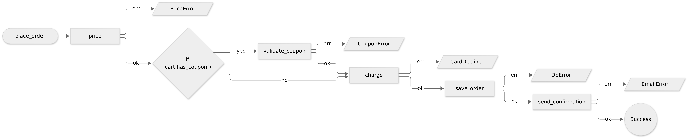

<details>
<summary>Mermaid source</summary>

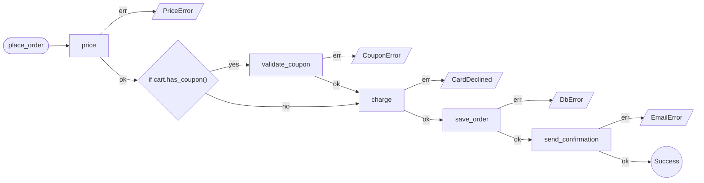

</details>

Each `?` becomes a step with an exit to the error it returns. The coupon check only runs on one branch, and you can see it. Five ways to fail, one way to succeed.

Names like `PriceError` and `CardDeclined` come from the called functions' signatures, which `errpath` finds anywhere in the same crate. Without a signature, a step shows the enclosing function's error.

## A two-line PR that hides two problems

```diff
-    let total = price(cart)?;
+    let total = price(cart).expect("cart was priced");
 ...
-    send_confirmation(&receipt)?;
+    let _ = send_confirmation(&receipt);
```

It compiles without warnings and passes default Clippy. In review it reads as tidying up. `errpath` posts this on the PR:

> ## Error path review: high risk
>
> 1 function changed, 2 new findings.
>
> ### New findings
>
> - `no-panic` `price.expect can panic` at `src/checkout.rs:2`
> - `no-swallow` `let _ = drops the error from send_confirmation` at `src/checkout.rs:8`
>
> ### Changed error paths
>
> #### `checkout::place_order`
>
> - added panic path `price.expect`
> - added dropped error from `send_confirmation`
> - removed step `price` → `PriceError`
> - removed step `send_confirmation` → `EmailError`

The comment includes the function's new diagram. A pricing failure now panics, and a failed confirmation email still reaches Success:

<p align="center">
  
</p>

<details>
<summary>The Mermaid source errpath posts</summary>

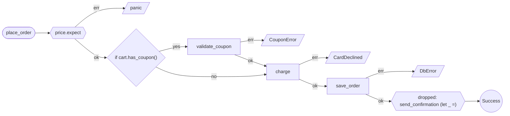

</details>

Maybe both changes are deliberate. Then the author says so in one comment (see [allowing a finding](#allowing-a-finding)), and reviewers see the reason.

## Silent when nothing changed

Rename `total` to `order_total`, reformat the file or add comments, and `errpath` prints nothing. A codebase with years of `unwrap`s stays quiet too: it reports only what the change introduced.

## Get started

```bash
cargo install cargo-errpath
cargo errpath init
```

`init` writes two files and never overwrites one:

- `.github/workflows/errpath.yml` runs `cargo errpath check` and `cargo test` on every pull request, and posts the review comment.
- `.claude/settings.json` adds three [Claude Code hooks](#coding-agents). A coding agent then fixes these problems as it works, before you review anything.

When a file already exists, `init` prints what to merge into it.

## One gate: `check`

```bash
cargo errpath check
```

`check` runs the tools a Rust project should already use, then errpath:

| Step | Runs | Fails on |
| --- | --- | --- |
| `fmt` | `cargo fmt --all --check` | unformatted code |
| `clippy` | `cargo clippy --workspace --all-targets -- -D warnings` | any warning, including an unused `Result` |
| `errpath` | `review` against the branch's base, uncommitted edits included | a new `unwrap`, `expect`, panic, dropped error, or error handled without recording it, with no allow comment |
| `deny` | `cargo deny check`, when cargo-deny and a `deny.toml` are present | advisories, licences, bans |
| `shear` | `cargo shear`, when cargo-shear is installed | unused dependencies |

Like cargo, `check` uses the workspace of the directory you run it in. It prints one line per step, with each failure's output, and exits 1 if any step failed. A finding errpath is only `possible` about, such as `let _ = tx.send(1)` where it can't see what `send` returns, is listed but doesn't fail the step. Missing optional tools are reported as skipped. The base is `origin/HEAD`, else `main` or `master`. Pass `--base <ref>` to pick another.

errpath fails only on *new* findings, so `check` works on a codebase with years of `unwrap`s from day one. Clippy's `unwrap_used` is all or nothing: deny it and every existing `unwrap` fails the build. Risk ratings aren't a gate either. A moved step is worth a reviewer's look, but it shouldn't block a merge.

Want a review without the other tools? `review` compares your branch, uncommitted edits included, with `main`:

```bash
cargo errpath review --base main
```

`--head <ref>` reviews a commit instead, and then the work tree is ignored.

## Coding agents

An agent runs the compiler until its code builds, so the regressions it ships are the ones that compile. errpath catches the error-path ones: an `unwrap` where a `?` was, or an error dropped to make a type line up.

`cargo errpath init` sets up these hooks:

- **When a session starts**, `cargo errpath hook start` records the commit it began from, or the empty tree in a repo with no commits yet. Work the agent commits during the session still counts as its own, even after you exit and resume. The record lives in `.git/errpath/` and is pruned after 30 days untouched.
- **After every edit** to a `.rs` file, `cargo errpath hook edit` reviews that file's changes since the session began. It needs no build and takes 0.6s on tokio's 555 files. A new finding goes back to the agent, which fixes it in the same turn.
- **Before the agent finishes**, `cargo errpath hook stop` runs `check` against the session's starting commit. It runs fmt, Clippy, deny and shear in every Cargo workspace the session changed, wherever in the repository the agent is working. A changed shared config, such as a root `.cargo/config.toml` or `rustfmt.toml`, counts as a change to every workspace below it. A change to Rust code, `Cargo.toml`, `Cargo.lock` or the rustfmt, Clippy, cargo-deny, toolchain or Cargo config files triggers it. The agent can't hand back until fmt, Clippy and errpath pass. If its fix still fails, the hook blocks only once and then tells you, so the agent never gets stuck in a loop.

The stop hook always shows you two things, pass or fail:

- **Every new allow comment and its reason.** An agent can silence a finding the same way a person can, so you see each one.
- **Code errpath couldn't analyse**, such as a file it couldn't read or a new function wrapped in a macro. This doesn't block, because rustc and Clippy still checked that code.

The hooks are a thin layer over `check`, which any agent or editor can run.

## More shapes

Every diagram below is unedited `cargo errpath diagram` output.

### A retry loop

The loop shows as a box. Two arms leave it, and the guarded arm goes round again.

```rust
fn fetch_with_retry(url: &str) -> Result<Body, FetchError> {
    let mut attempts = 0;
    loop {
        match get(url) {
            Ok(body) => return Ok(body),
            Err(e) if attempts < 3 => attempts += 1,
            Err(e) => return Err(FetchError::GaveUp(e)),
        }
    }
}
```

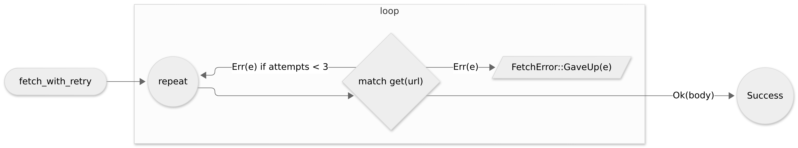

<details>
<summary>Mermaid source</summary>

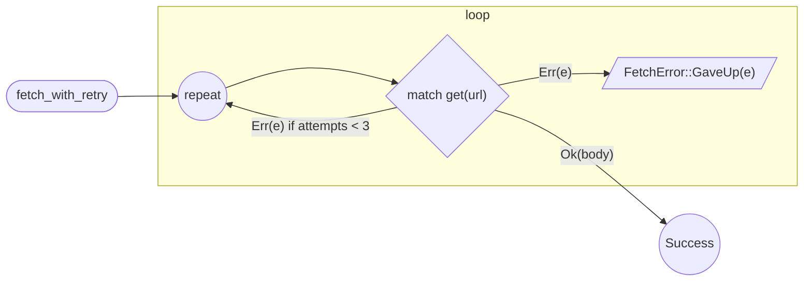

</details>

### A `match` on a request

Each arm gets its own path, and `Route::Health` has no way to fail.

```rust
fn handle(req: Request) -> Result<Response, ApiError> {
    let user = authenticate(&req)?;
    match req.route() {
        Route::Orders => list_orders(&user),
        Route::Refund(id) => {
            let order = load_order(id)?;
            refund(&order).map_err(ApiError::Refund)
        }
        Route::Health => Ok(Response::ok()),
    }
}
```

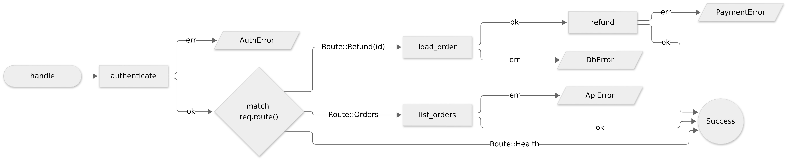

<details>
<summary>Mermaid source</summary>

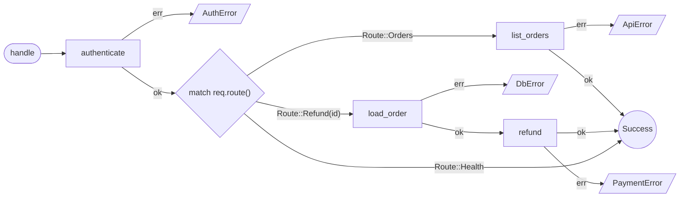

</details>

### Early returns

`return Ok` skips the rest. `return Err` is an exit of its own.

```rust
fn import(file: &Path) -> Result<Summary, ImportError> {
    let rows = read_csv(file)?;
    if rows.is_empty() {
        return Ok(Summary::empty());
    }
    let valid = validate(&rows)?;
    if valid.len() < rows.len() {
        return Err(ImportError::Invalid(rows.len() - valid.len()));
    }
    save_all(&valid)?;
    Ok(Summary::new(valid.len()))
}
```

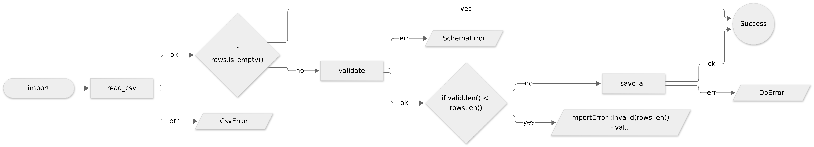

<details>
<summary>Mermaid source</summary>

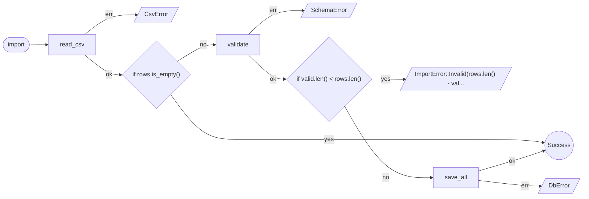

</details>

### Closures and async blocks

The closure passed to `traced` is drawn as its own box, inside the function that calls it.

```rust
async fn sync_account(id: AccountId) -> Result<(), SyncError> {
    let account = load(id).await?;
    traced("sync", || async {
        let remote = fetch_remote(&account).await?;
        merge(&account, remote)?;
        Ok(())
    })
    .await?;
    notify(&account).await?;
    Ok(())
}
```

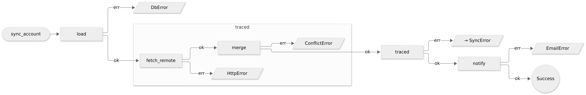

<details>
<summary>Mermaid source</summary>

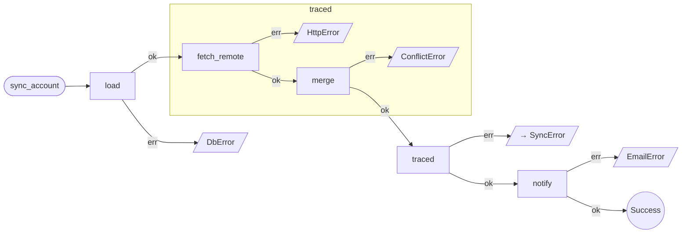

</details>

## What it flags

| Risk | Change |
| --- | --- |
| **High** | An error is certainly dropped: `let _ = commit();`, `commit().ok();` |
| **Moderate** | A new `unwrap`, `expect`, `panic!` or `todo!` |
| | An error may be dropped, but the callee's type isn't visible: `let _ = tx.send(1);` |
| | A step moved into or out of a branch or loop, or a condition changed |
| | An error conversion changed: `map_err(Top::A)` to `map_err(Top::B)` |
| | Exits reordered, a return type changed, or `break`/`continue` added or retargeted |
| | An error handled or ignored without recording it, so it never reaches your traces: `if let Err(e) = send() { retry() }` |
| | An error handled where it happens added, removed, or changed to catch a different error: `if let Err(e) = send() { log(e) }` |
| **Low** | A step, failure exit or early return added or removed |
| | `.context("...")` text or `match` arms changed |

Moved and renamed functions are matched up, so moving code doesn't count as new. Risk points you at the change. The code around it decides whether it matters.

## Errors you can see in your traces

An error handled where it happens leaves no trace unless the handler records it. The service carries on, and nobody learns the email never went. The `no-trace` rule flags a new handler that records nothing:

```rust
// flagged: the error stops here, and nothing records it
if let Err(e) = send_confirmation(&receipt) {
    retry_later(&receipt);
}

// passes: the error reaches your traces
if let Err(e) = send_confirmation(&receipt) {
    tracing::warn!(error = %e, "confirmation email failed");
    retry_later(&receipt);
}
```

Every handler on a `Result` is checked, including one that ends in `return;`, `continue` or a fallback value. Only the arms that see the error count: an `Err(..)` or catch-all arm, or the `else` of `if let Ok`. An `if let Ok` with no `else` ignores the error, and is flagged too. Every path through the handler has to record, so `if fatal { return Err(e); } retry();` is flagged: the path that retries drops the error. errpath follows `if`, `match` arms and guards, `&&` and `||`, loops, and the arguments of standard macros such as `println!` and `assert!`. A path is fine when:

- it hands the error on, with `return Err(..)`, or panics (which `no-panic` reports)
- it emits a `tracing` event: `tracing::warn!`, `t::warn!` after `use tracing as t`, or a bare `warn!`, `error!`, `info!`, `debug!`, `trace!` or `event!` imported from `tracing`. Imports resolve as rustc does: a fn sees its own `use` items, its blocks' and its module's, and a child module doesn't inherit its parent's
- it calls a span method that records (`record_error`, `record_exception`, `add_event`, `set_status`, `record`), or anything in [autotel](https://crates.io/crates/autotel)

`log::warn!`, `eprintln!` and `println!` don't count: the first needs a bridge to reach OpenTelemetry, and the others never do. Logging in a closure or async block doesn't count either, because nothing says it runs. A bare macro nothing imports, like `error!` under `#[macro_use] extern crate log`, is reported with `possible` confidence and a hint to import it from `tracing`.

This is a static check. It shows each error reaches a `tracing` event or span. Whether that reaches your backend depends on the service setting up an exporter.

To export `tracing` events over OTLP, add autotel and make this the first line of `main`:

```rust
let _telemetry = autotel::init(autotel::config!().with_tracing_subscriber())?;
```

`cargo errpath init` suggests this when no manifest in the repository brings in autotel or the OpenTelemetry SDK.

## Allowing a finding

Some dropped errors are deliberate. Write the reason on the line above or at the end of the line:

```rust
// errpath: allow(no-swallow) a failed email must not fail the order
let _ = send_confirmation(&receipt);
```

The reason is required, and every new allow still appears in the review, so nothing gets silenced unseen.

## Good to know

`errpath` reads syntax, which is why it needs no build. Every review states how much it analysed.

<details>
<summary>What syntax alone can't see</summary>

- **Macros.** A `?` inside a macro call is counted but not placed. Functions wrapped entirely in a macro, like `cfg_rt! { .. }`, aren't analysed.
- **Types.** `errpath` names each error from the called function's signature, matched by name across the crate. A binary and its package's library count as separate crates, as `rustc` builds them. On real crates about half of steps get a named error. The rest show the enclosing function's error, or "unknown error". Names are matched without `use` paths, so a crate fn can claim a call to a dependency's fn of the same name. A method call like `x.load()` matches within its own file, since syntax can't tell the type of `x`.
- **Implicit conversions.** A change inside `impl From<A> for B` doesn't appear at the `?` that uses it.
- **Data flow.** A loop with nothing fallible can set a variable that a later `if` fails on. The two aren't connected.
- **Identical calls.** Steps are identified by callee, not arguments, so swapping two `read(r)?` calls that differ only in their arguments looks the same.
- **Diverging calls.** A call to a `fn() -> !` isn't known to stop the path, and `while true {}` isn't treated as endless.
- **Recovery.** `if let Err(e) = a() { log(e) }`, and a `match` on `Ok`/`Err` with nothing fallible in its arms, show as a handled step. The diagram shows that the error stops there, and leaves out what the handler does with it. A returned arm that rebinds or assigns its error before returning it shows neither a handled step nor an exit. `unwrap_or_else` and `or_else` count as plain calls.
- **Test code.** `#[test]`, `#[cfg(test)]` and a package's `tests/`, `benches/` and `examples/` are skipped. Code behind `cfg(any(test, feature = "..."))` is analysed, because a feature can be on in production.

These edits produce a report even though behaviour stays the same:

- Renaming a variable that shadows a parameter, as in `let now = now.as_secs();`.
- Renaming a variable captured by name in a string, as in `format!("{ca}")`.
- Renaming a closure parameter used in a condition.
- A trailing comma after a turbofish call, as in `f::<T>(x,)`.

</details>

<details>
<summary>How it's tested</summary>

A mutation test applies hundreds of small edits to real syntax. Edits to failure paths must be reported, and edits that leave them alone must stay silent. On 2,353 mutants from four popular crates, 2,350 got the right answer. The other 3 were renames of shadowing variables. Score your own code with:

```bash
MUTATE_PATH=path/to/src cargo test real_code -- --ignored --nocapture
```

Over the last 30 commits of three popular crates, it reported on 39 of 90: 15 low risk, 24 moderate, none high. With the default settings that's 24 PR comments.

</details>

## Reference

<details>
<summary>Commands</summary>

```bash
cargo errpath init                                       # CI workflow and agent hooks
cargo errpath check                                      # fmt, Clippy, errpath, deny, shear
cargo errpath check --base origin/release                # against another base
cargo errpath review --base main                         # markdown to stdout
cargo errpath review --base main --head my-branch        # any two refs
cargo errpath review --base main crates/billing          # only some paths
cargo errpath review --base main --format json -o r.json # for tools
cargo errpath review --base main --diagrams collapsed    # diagrams in <details>
cargo errpath diagram src/checkout.rs place_order        # one function, Mermaid
cargo errpath ir src                                     # the analysis, as JSON
```

Without `--head`, `review` reads your work tree, uncommitted and untracked files included. With it, both sides come from git. Either way it starts from the merge base, so work merged to `main` after you branched doesn't count as yours.

</details>

<details>
<summary>GitHub Action inputs and outputs</summary>

| Input | Default | |
| --- | --- | --- |
| `comment-on` | `moderate` | Lowest risk that gets a comment: `low`, `moderate` or `high` |
| `fail-on` | `never` | Fail the job at this risk or above: `never`, `moderate` or `high` |
| `comment` | `true` | Post a PR comment at all |
| `annotations` | `true` | Annotate new findings inline |
| `diagrams` | `collapsed` | Diagrams in the comment: `open` or `collapsed` |
| `path` | | Paths to review, space separated |
| `base`, `head` | the PR's | Refs to compare |
| `version` | the action's tag | `cargo-errpath` version to install |
| `cli` | | A command to run instead of installing |

Outputs: `risk`, `changed`, and `report`, the path of the JSON report.

A fork PR's token can't comment, so its review stays in the job summary and annotations. Leave `fail-on` at `never` until you've read a few weeks of output on your code.

</details>

<details>
<summary>JSON</summary>

`review --format json` gives `risk`, `changed`, `markdown`, `newFindings`, `new_allows`, `functions`, `coverage`, `notes` and more. `ir` gives the analysis itself. Both carry a `schema_version`.

</details>

## Agent skill

```bash
npx skills add jagreehal/errpath --skill errpath
```

The [skill](skills/errpath/SKILL.md) teaches a coding agent to run a review and act on its findings.

Give an agent the [two-line PR above](#a-two-line-pr-that-hides-two-problems). It runs `cargo errpath review --base main --format json` and reads:

```json
{
  "risk": "high",
  "newFindings": [
    { "severity": "warning", "rule": "no-panic", "line": 2,
      "message": "`price.expect` can panic", "confidence": "certain" },
    { "severity": "error", "rule": "no-swallow", "line": 8,
      "message": "`let _ =` drops the error from `send_confirmation`", "confidence": "certain" }
  ]
}
```

A pricing failure should reach the caller, so the agent restores the `?`. A failed email shouldn't cancel a paid order, so the agent logs that error:

```rust
let total = price(cart)?;
// ...
if let Err(e) = send_confirmation(&receipt) {
    log::warn!("confirmation email failed: {e}");
}
```

The agent reviews again and gets no findings. Reviewers still see the email decision:

> - added handled error from `send_confirmation`
> - removed step `send_confirmation` → `EmailError`

## License

Apache-2.0
