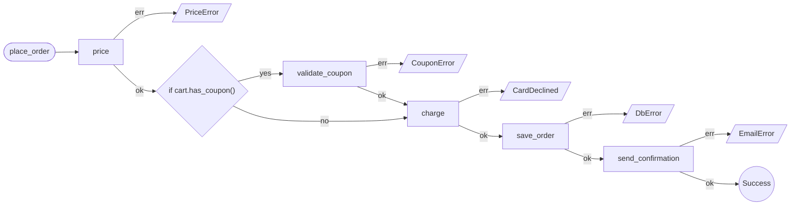
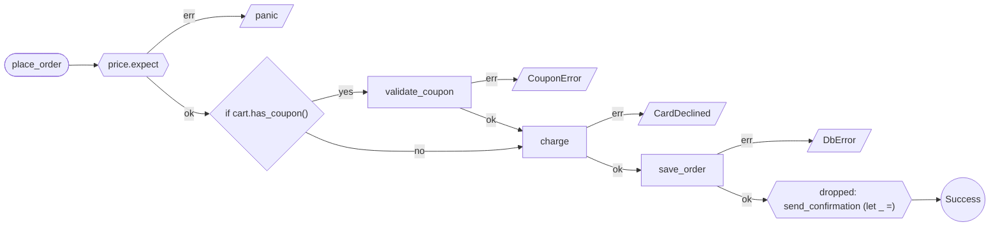
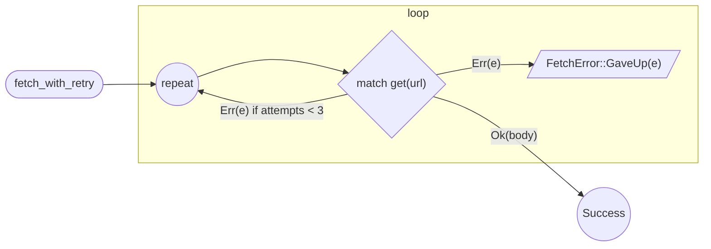
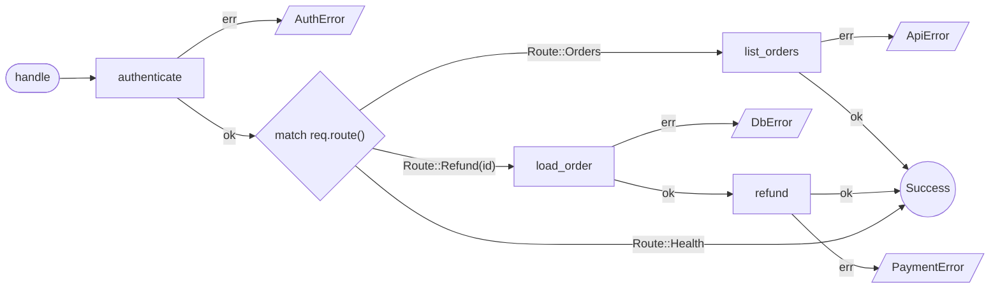
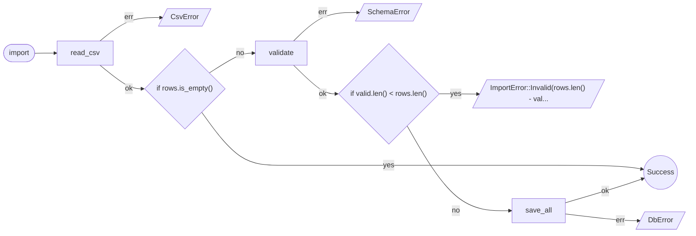
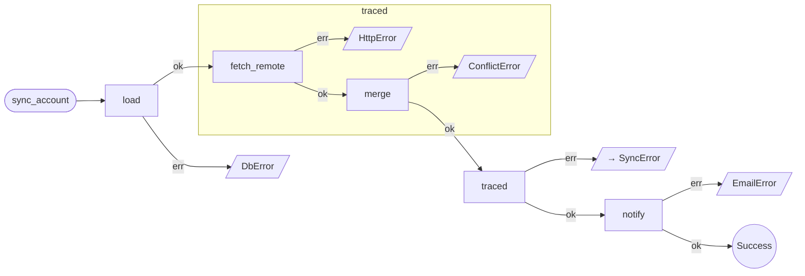

# errpath

**See how a Rust pull request changes error handling.**

`errpath` is a CLI and GitHub Action that highlights new panic paths, dropped errors and changes to error propagation. Reviewers get a focused before-and-after report, with diagrams showing where failures leave each function.

It reads Rust source. No build required, and nothing to add to your project.

```bash
cargo install cargo-errpath
```

<p align="center">
  
</p>

## Your function, as a diagram

```rust
pub fn place_order(cart: &Cart, card: &Card) -> Result<Receipt, OrderError> {
    let total = price(cart)?;
    if cart.has_coupon() {
        validate_coupon(cart)?;
    }
    let payment = charge(card, total).map_err(OrderError::Payment)?;
    let receipt = save_order(cart, &payment)?;
    send_confirmation(&receipt)?;
    Ok(receipt)
}
```

```bash
cargo errpath diagram src/checkout.rs place_order
```



Each `?` becomes a step with an exit to the error it returns. The coupon check only runs on one branch, and you can see it. Five ways to fail, one way to succeed.

Names like `PriceError` and `CardDeclined` come from the called functions' signatures, which `errpath` finds anywhere in the same crate. Without a signature, a step shows the enclosing function's error.

## A two-line PR that hides two problems

```diff
-    let total = price(cart)?;
+    let total = price(cart).expect("cart was priced");
 ...
-    send_confirmation(&receipt)?;
+    let _ = send_confirmation(&receipt);
```

It compiles without warnings and passes default Clippy. In review it reads as tidying up. `errpath` posts this on the PR:

> ## Error path review: high risk
>
> 1 function changed, 2 new findings.
>
> ### New findings
>
> - `no-panic` `price.expect can panic` at `src/checkout.rs:2`
> - `no-swallow` `let _ = drops the error from send_confirmation` at `src/checkout.rs:8`
>
> ### Changed error paths
>
> #### `checkout::place_order`
>
> - added panic path `price.expect`
> - added dropped error from `send_confirmation`
> - removed step `price` → `PriceError`
> - removed step `send_confirmation` → `EmailError`

The comment includes the function's new diagram. A pricing failure now panics, and a failed confirmation email still reaches Success:

<p align="center">
  
</p>

<details>
<summary>The Mermaid source errpath posts</summary>



</details>

Maybe both changes are deliberate. Then the author says so in one comment (see [allowing a finding](#allowing-a-finding)), and reviewers see the reason.

## Silent when nothing changed

Rename `total` to `order_total`, reformat the file or add comments, and `errpath` prints nothing. A codebase with years of `unwrap`s stays quiet too: it reports only what the change introduced.

## Get started

On your machine, commit your work, then compare your branch with `main`:

```bash
cargo errpath review --base main
```

`review` reads both refs from git and ignores uncommitted edits.

On every pull request, add `.github/workflows/errpath.yml`:

```yaml
name: errpath
on: pull_request
permissions:
  contents: read
  pull-requests: write
jobs:
  review:
    runs-on: ubuntu-latest
    steps:
      - uses: actions/checkout@v7
        with:
          fetch-depth: 0
      - uses: jagreehal/errpath@v0.1.0
```

You get one PR comment that updates as the branch changes, inline annotations on new findings, and a job summary. Low-risk changes skip the comment and appear only in the summary.

## More shapes

Every diagram below is unedited `cargo errpath diagram` output.

### A retry loop

The loop shows as a box. Two arms leave it, and the guarded arm goes round again.

```rust
fn fetch_with_retry(url: &str) -> Result<Body, FetchError> {
    let mut attempts = 0;
    loop {
        match get(url) {
            Ok(body) => return Ok(body),
            Err(e) if attempts < 3 => attempts += 1,
            Err(e) => return Err(FetchError::GaveUp(e)),
        }
    }
}
```



### A `match` on a request

Each arm gets its own path, and `Route::Health` has no way to fail.

```rust
fn handle(req: Request) -> Result<Response, ApiError> {
    let user = authenticate(&req)?;
    match req.route() {
        Route::Orders => list_orders(&user),
        Route::Refund(id) => {
            let order = load_order(id)?;
            refund(&order).map_err(ApiError::Refund)
        }
        Route::Health => Ok(Response::ok()),
    }
}
```



### Early returns

`return Ok` skips the rest. `return Err` is an exit of its own.

```rust
fn import(file: &Path) -> Result<Summary, ImportError> {
    let rows = read_csv(file)?;
    if rows.is_empty() {
        return Ok(Summary::empty());
    }
    let valid = validate(&rows)?;
    if valid.len() < rows.len() {
        return Err(ImportError::Invalid(rows.len() - valid.len()));
    }
    save_all(&valid)?;
    Ok(Summary::new(valid.len()))
}
```



### Closures and async blocks

The closure passed to `traced` is drawn as its own box, inside the function that calls it.

```rust
async fn sync_account(id: AccountId) -> Result<(), SyncError> {
    let account = load(id).await?;
    traced("sync", || async {
        let remote = fetch_remote(&account).await?;
        merge(&account, remote)?;
        Ok(())
    })
    .await?;
    notify(&account).await?;
    Ok(())
}
```



## What it flags

| Risk | Change |
| --- | --- |
| **High** | An error is certainly dropped: `let _ = commit();`, `commit().ok();` |
| **Moderate** | A new `unwrap`, `expect`, `panic!` or `todo!` |
| | An error may be dropped, but the callee's type isn't visible: `let _ = tx.send(1);` |
| | A step moved into or out of a branch or loop, or a condition changed |
| | An error conversion changed: `map_err(Top::A)` to `map_err(Top::B)` |
| | Exits reordered, a return type changed, or `break`/`continue` added or retargeted |
| **Low** | A step, failure exit or early return added or removed |
| | `.context("...")` text or `match` arms changed |

Moved and renamed functions are matched up, so moving code doesn't count as new. Risk points you at the change. The code around it decides whether it matters.

## Allowing a finding

Some dropped errors are deliberate. Write the reason on the line above or at the end of the line:

```rust
// errpath: allow(no-swallow) a failed email must not fail the order
let _ = send_confirmation(&receipt);
```

The reason is required, and every new allow still appears in the review, so nothing gets silenced unseen.

## Good to know

`errpath` reads syntax, which is why it needs no build. Every review states how much it analysed.

<details>
<summary>What syntax alone can't see</summary>

- **Macros.** A `?` inside a macro call is counted but not placed. Functions wrapped entirely in a macro, like `cfg_rt! { .. }`, aren't analysed.
- **Types.** `errpath` names each error from the called function's signature, matched by name across the crate. A binary and its package's library count as separate crates, as `rustc` builds them. On real crates about half of steps get a named error. The rest show the enclosing function's error, or "unknown error". Names are matched without `use` paths, so a crate fn can claim a call to a dependency's fn of the same name. A method call like `x.load()` matches within its own file, since syntax can't tell the type of `x`.
- **Implicit conversions.** A change inside `impl From<A> for B` doesn't appear at the `?` that uses it.
- **Data flow.** A loop with nothing fallible can set a variable that a later `if` fails on. The two aren't connected.
- **Identical calls.** Steps are identified by callee, not arguments, so swapping two `read(r)?` calls that differ only in their arguments looks the same.
- **Diverging calls.** A call to a `fn() -> !` isn't known to stop the path, and `while true {}` isn't treated as endless.
- **Recovery.** `if let Err(e) = a() { .. }` handles an error without a step, so it isn't tracked as an exit.
- **Test code.** `#[test]`, `#[cfg(test)]` and a package's `tests/`, `benches/` and `examples/` are skipped. Code behind `cfg(any(test, feature = "..."))` is analysed, because a feature can be on in production.

These edits produce a report even though behaviour stays the same:

- Renaming a variable that shadows a parameter, as in `let now = now.as_secs();`.
- Renaming a variable captured by name in a string, as in `format!("{ca}")`.
- Renaming a closure parameter used in a condition.
- A trailing comma after a turbofish call, as in `f::<T>(x,)`.

</details>

<details>
<summary>How it's tested</summary>

A mutation test applies hundreds of small edits to real syntax. Edits to failure paths must be reported, and edits that leave them alone must stay silent. On 2,353 mutants from four popular crates, 2,350 got the right answer. The other 3 were renames of shadowing variables. Score your own code with:

```bash
MUTATE_PATH=path/to/src cargo test real_code -- --ignored --nocapture
```

Over the last 30 commits of three popular crates, it reported on 39 of 90: 15 low risk, 24 moderate, none high. With the default settings that's 24 PR comments.

</details>

## Reference

<details>
<summary>Commands</summary>

```bash
cargo errpath review --base main                         # markdown to stdout
cargo errpath review --base main --head my-branch        # any two refs
cargo errpath review --base main crates/billing          # only some paths
cargo errpath review --base main --format json -o r.json # for tools
cargo errpath review --base main --diagrams collapsed    # diagrams in <details>
cargo errpath diagram src/checkout.rs place_order        # one function, Mermaid
cargo errpath ir src                                     # the analysis, as JSON
```

`review` reads both refs from git, not your working tree, and starts from their merge base, so work merged to `main` after you branched doesn't count as yours.

</details>

<details>
<summary>GitHub Action inputs and outputs</summary>

| Input | Default | |
| --- | --- | --- |
| `comment-on` | `moderate` | Lowest risk that gets a comment: `low`, `moderate` or `high` |
| `fail-on` | `never` | Fail the job at this risk or above: `never`, `moderate` or `high` |
| `comment` | `true` | Post a PR comment at all |
| `annotations` | `true` | Annotate new findings inline |
| `diagrams` | `collapsed` | Diagrams in the comment: `open` or `collapsed` |
| `path` | | Paths to review, space separated |
| `base`, `head` | the PR's | Refs to compare |
| `version` | the action's tag | `cargo-errpath` version to install |
| `cli` | | A command to run instead of installing |

Outputs: `risk`, `changed`, and `report`, the path of the JSON report.

A fork PR's token can't comment, so its review stays in the job summary and annotations. Leave `fail-on` at `never` until you've read a few weeks of output on your code.

</details>

<details>
<summary>JSON</summary>

`review --format json` gives `risk`, `changed`, `markdown`, `newFindings`, `new_allows`, `functions`, `coverage`, `notes` and more. `ir` gives the analysis itself. Both carry a `schema_version`.

</details>

## Agent skill

```bash
npx skills add jagreehal/errpath --skill errpath
```

The [skill](skills/errpath/SKILL.md) teaches a coding agent to run a review and act on its findings.

## License

Apache-2.0
